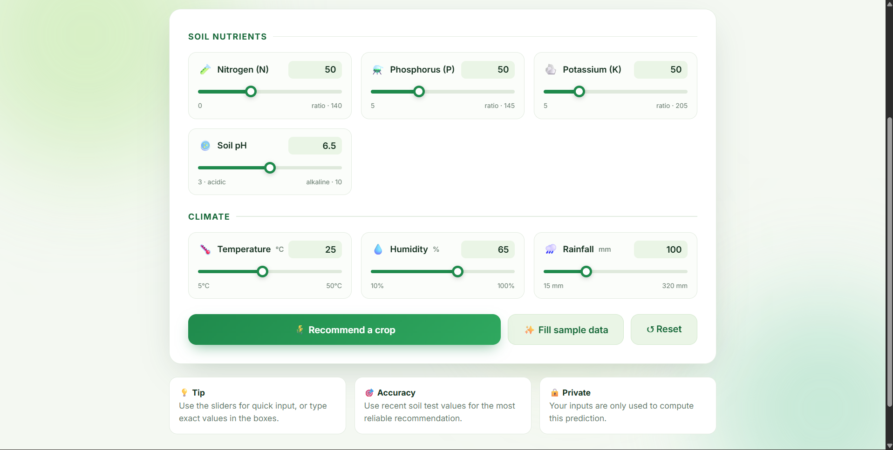
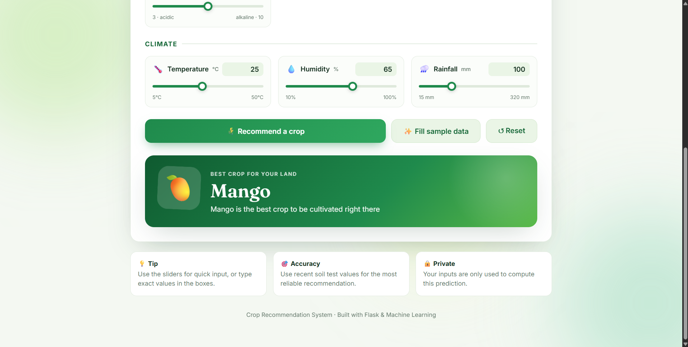

# 🌾 CropWise: Smart Crop Recommendation System

A Flask web app that recommends the most suitable crop to cultivate based on soil nutrients and local climate conditions, powered by a machine learning model.

Enter your soil's Nitrogen, Phosphorus, Potassium and pH values together with temperature, humidity and rainfall, and the app predicts the best crop for your land.

---

## 📸 Screenshots

### Input form


### Prediction result


---

## ✨ Features

- 🎛️ Clean, responsive UI with synced sliders and number inputs
- ⏳ Animated loader while the prediction is computed
- 🎯 Result card with the recommended crop and a matching emoji
- ✨ One-click sample data and reset buttons
- 💾 Inputs are kept after prediction so you can tweak and re-run
- 📱 Works on desktop and mobile

## 🌱 Supported crops (22)

Rice, Maize, Jute, Cotton, Coconut, Papaya, Orange, Apple, Muskmelon, Watermelon, Grapes, Mango, Banana, Pomegranate, Lentil, Blackgram, Mungbean, Mothbeans, Pigeonpeas, Kidneybeans, Chickpea, Coffee

## 📥 Input features

| Feature | Field name | Unit |
|---|---|---|
| Nitrogen ratio in soil | `Nitrogen` | ratio |
| Phosphorus ratio in soil | `Phosphorus` | ratio |
| Potassium ratio in soil | `Potassium` | ratio |
| Temperature | `Temperature` | °C |
| Relative humidity | `Humidity` | % |
| Soil pH | `Ph` | pH |
| Rainfall | `Rainfall` | mm |

## ⚙️ How it works

1. The user submits the form to the `/predict` route.
2. The 7 values are scaled with a `MinMaxScaler`, then a `StandardScaler`.
3. The trained model predicts a crop label (1–22).
4. The label is mapped to a crop name and shown on the page.

## 🗂️ Project structure

```
.
├── app.py                 # Flask application
├── model.pkl              # Trained model
├── minmaxscaler.pkl       # MinMax scaler
├── standardscaler.pkl     # Standard scaler
├── requirements.txt
├── templates/
│   └── index.html         # Frontend (form, loader, result)
└── images/
    ├── form.png
    └── result.png
```

## 🚀 Getting started

### 1. Clone the repository

```bash
git clone https://github.com/<your-username>/<your-repo>.git
cd <your-repo>
```

### 2. Create a virtual environment (recommended)

```bash
python -m venv venv
source venv/bin/activate      # Windows: venv\Scripts\activate
```

### 3. Install dependencies

```bash
pip install -r requirements.txt
```

### 4. Run the app

```bash
python app.py
```

Open **http://127.0.0.1:5000** in your browser.

## 🧪 Try it with sample data

Click **"Fill sample data"** in the UI, or enter:

| N | P | K | Temp | Humidity | pH | Rainfall |
|---|---|---|------|----------|----|----------|
| 90 | 42 | 43 | 21 | 82 | 6.5 | 203 |

## 🛠️ Tech stack

- **Backend:** Python, Flask
- **ML:** scikit-learn, NumPy, pandas
- **Frontend:** HTML, CSS, vanilla JavaScript

## ⚠️ Notes

- Use the same scikit-learn version the model was trained with, otherwise loading the `.pkl` files may fail or warn.
- Predictions are a decision aid, not a replacement for advice from a local agronomist.

## 🤝 Contributing

Contributions are welcome. Fork the repo, create a branch, and open a pull request.
